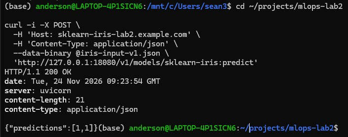
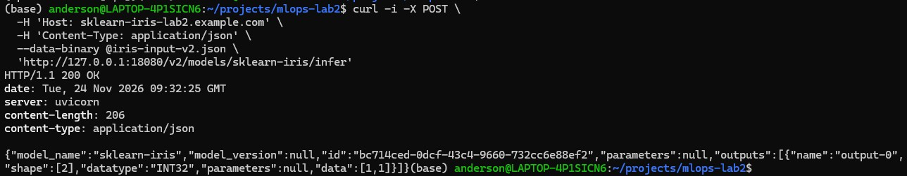
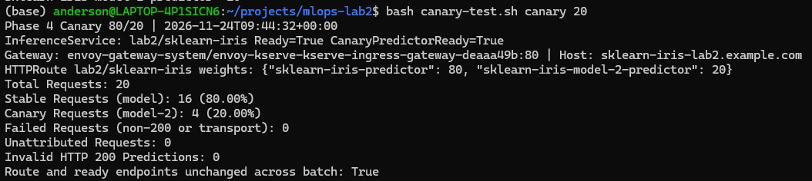
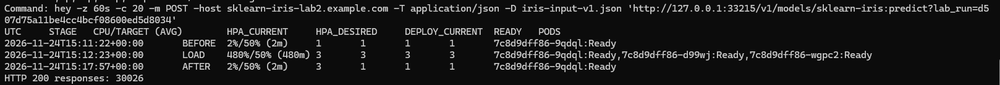
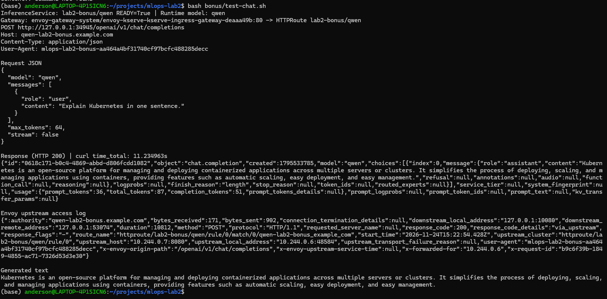
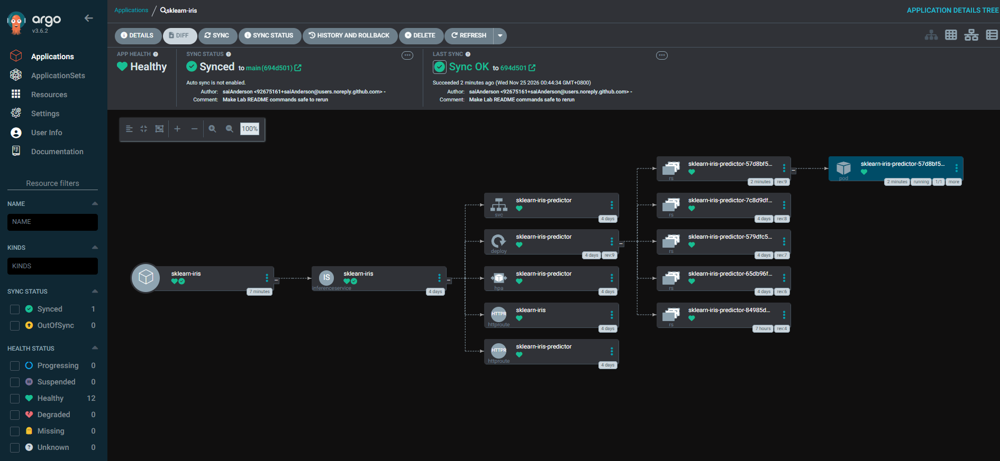

# MLOps Lab 2 · Serving Models with KServe

## Project Overview

本專案依課程講義第 49–50 頁及 TA 公告，在 kind 叢集以 KServe Standard 部署 `sklearn-iris`，驗證 V1／V2 推論、Canary／Promotion 與 CPU Autoscaling。下方各階段預設在 WSL Ubuntu 的同一個 Bash 終端機依序執行。若專案位於其他目錄，請將範例中的 `~/projects/mlops-lab2` 換成實際路徑。

## 作業交付清單

| 作業項目 | 部署與測試檔案 | 執行結果 |
|---|---|---|
| KServe Deployment | [InferenceService YAML](sklearn-iris.yaml) | [部署截圖](test-results/01-isvc-ready.png)，`READY=True` |
| Model Inference | [推論腳本](test-inference.sh) · [V1 輸入](iris-input-v1.json) · [V2 輸入](iris-input-v2.json) | [V1 截圖](test-results/02-inference-v1.png) · [V2 截圖](test-results/03-inference-v2.png)，兩者皆為 HTTP 200，預測 `[1, 1]` |
| Canary Deployment | [Canary YAML](sklearn-iris-canary.yaml) · [Promotion YAML](sklearn-iris-promote.yaml) · [分流測試腳本](canary-test.sh) | [11/24 分流統計截圖](test-results/04-canary-count.png)，舊版 16 筆、新版 4 筆 · [11/24 Promotion 紀錄](test-results/05-canary-promotion.txt)，5 筆皆由新版處理 |
| Autoscaling | [Autoscaling YAML](sklearn-iris-autoscaling.yaml) · [負載測試腳本](load-test.sh) | [副本變化截圖](test-results/05-autoscaling.png)，負載期間 Ready 副本由 1 增至 3，結束後回到 1 · [11/24 的 30 秒紀錄](test-results/autoscaling-2026-11-24-30s.txt) · [11/24 的 60 秒紀錄](test-results/autoscaling-2026-11-24-60s.txt) |
| Bonus · LLM Serving | [Qwen InferenceService](llm-serving-bonus/qwen-inferenceservice.yaml) · [ServingRuntime](llm-serving-bonus/qwen-servingruntime.yaml) · [聊天測試腳本](llm-serving-bonus/test-chat.sh) · [請求 JSON](llm-serving-bonus/chat-request.json) | [Chat Completion 截圖](llm-serving-bonus/test-results/06-llm-chat.png) · [執行紀錄](llm-serving-bonus/test-results/chat.txt)，HTTP 200 並回傳模型回答 |
| Bonus · Argo CD | [Application YAML](argocd-application.yaml)，同步 `sklearn-iris-autoscaling.yaml` | [同步結果截圖](test-results/09-argocd-sync.png)，`Synced`、`Healthy`、`Sync OK` |

## Architecture

WSL 的 `curl` 或 `hey` 經本機 port-forward 連到 **Envoy Gateway Service**。Gateway API 的 `HTTPRoute` 把請求送到 `lab2` 中由 KServe Standard 管理的 sklearn predictor Service 和 Pod。Canary 階段使用兩個加權後端，Promotion 後只剩 `model-2` 的正式後端。Metrics Server 從 kubelet 擷取 CPU 資料，KServe 管理的 HPA 用這些資料調整 predictor Deployment 副本數。

## Phase 2A：建立獨立的 kind 叢集

在 WSL2 Ubuntu 的 Bash 中執行。kind v0.33.0 使用固定的 Kubernetes v1.36.4 節點映像，符合 KServe v0.21.0 Standard 模式的 Kubernetes v1.32+ 需求，也與現有 `kubectl v1.37.1` 相差一個次版本。這階段只建立 Kubernetes 環境。[kind v0.33.0 映像清單](https://github.com/kubernetes-sigs/kind/releases/tag/v0.33.0) · [KServe Standard 版本需求](https://kserve.github.io/website/docs/admin-guide/kubernetes-deployment) · [kubectl 版本相容規則](https://kubernetes.io/releases/version-skew-policy/#kubectl)

### 盤點及建立

先檢查現有叢集、預設 context 及預設 kubeconfig 雜湊。若 `kind get clusters` 已列出 `kserve-lab2`，直接使用下方驗證步驟。

```bash
cd ~/projects/mlops-lab2
kind version
kind get clusters
kubectl config current-context
sha256sum "$HOME/.kube/config"
kubectl version --client
```

```bash
LAB_KUBECONFIG="$PWD/.kube/kserve-lab2.yaml"
mkdir -p -m 700 .kube
(
  umask 077
  KUBECONFIG="$LAB_KUBECONFIG" KIND_EXPERIMENTAL_PROVIDER=docker kind create cluster \
    --name kserve-lab2 \
    --image 'kindest/node:v1.36.4@sha256:099e049362a1526b2db71494e1947aae99bd16290d7c895f2b7ea312e3cbfaed' \
    --kubeconfig="$LAB_KUBECONFIG" --wait 5m
)
```

### 驗證

```bash
LAB_KUBECONFIG="$PWD/.kube/kserve-lab2.yaml"
lab=(kubectl --kubeconfig "$LAB_KUBECONFIG" --context kind-kserve-lab2 --cache-dir "$PWD/.kube/cache")

kubectl --kubeconfig "$LAB_KUBECONFIG" config get-contexts -o name
kubectl --kubeconfig "$LAB_KUBECONFIG" config current-context
"${lab[@]}" version
"${lab[@]}" get --raw='/readyz?verbose'
"${lab[@]}" wait --for=condition=Ready nodes --all --timeout=120s
"${lab[@]}" wait --for=condition=Ready pods --all --all-namespaces --timeout=180s
"${lab[@]}" get nodes -o wide
"${lab[@]}" get pods --all-namespaces

kind get clusters
kubectl config current-context
sha256sum "$HOME/.kube/config"
```

本次 Lab context 為 `kind-kserve-lab2`、Server 為 `v1.36.4`，`/readyz` 回報 `readyz check passed`。控制平面 Ready，9 個內建 Pods 全數 `1/1 Running`。建置前後比對 `test-cluster` 的節點、系統 Pod 與 Docker 容器識別資料均一致。

初次跨 Windows 殼層下指令時，kind 將新 context 寫入了預設 kubeconfig。已使用 `kind export kubeconfig --name=kserve-lab2 --kubeconfig="$LAB_KUBECONFIG"` 匯出獨立檔案，並按建置前的 SHA-256 核對及還原預設 kubeconfig。預設 context 已復原至 `kind-test-cluster`。重現建置時請在 WSL Bash 內執行上述指令。

### Phase 2B 的 kubeconfig

`.kube/kserve-lab2.yaml` 含叢集存取憑證，整個 `.kube/` 已由 Git 忽略。後續安裝前先確認這份檔案只有 `kind-kserve-lab2` context。明確傳入 `--kubeconfig "$LAB_KUBECONFIG"`，或只對已審閱的安裝程序設定 `KUBECONFIG="$LAB_KUBECONFIG"`，讓子程序也使用同一份檔案。

## Phase 2B：KServe v0.21.0 Standard

在既有 `kserve-lab2` 上以原生 WSL Ubuntu Bash 安裝。盤點時 Docker 為 29.9.1，Kubernetes 為 v1.36.4，API `/readyz` 為 `ok`，WSL 有 13 GiB 可用 RAM。Helm 未安裝。已下載官方 v0.21.0 Quickstart 腳本、核對 GitHub Release SHA-256 並執行 `bash -n`。該腳本會安裝 Helm、Kustomize 和 yq，因此本次直接套用官方 manifests 與腳本內嵌的 KServe core YAML。所有叢集指令使用專用 kubeconfig 與指定 context。[KServe Quickstart](https://kserve.github.io/website/docs/getting-started/quickstart-guide) · [KServe Standard 安裝指南](https://kserve.github.io/website/docs/admin-guide/kubernetes-deployment)

### Environment & Versions

| 元件 | 實測版本與設定 |
|---|---|
| 主機工具 | WSL2 Ubuntu 24.04、Docker 29.9.1、kind v0.33.0、kubectl v1.37.1 |
| Kubernetes | v1.36.4，獨立 context `kind-kserve-lab2` |
| cert-manager | v1.21.3，提供 KServe admission webhook 憑證 |
| Envoy Gateway | v1.9.1，data plane 為 Envoy Proxy `distroless-v1.39.1` |
| Gateway API | v1.6.1，由 Envoy Gateway v1.9.1 發行檔提供 |
| KServe Controller 和 scikit-learn Runtime | v0.21.0，`defaultDeploymentMode=Standard`，`enableGatewayApi=true` |
| HTTP Gateway | `kserve/kserve-ingress-gateway`，內部 ClusterIP 80/TCP，允許 `lab2` 命名空間掛載路由。設定見 [infra/gateway.yaml](infra/gateway.yaml)。 |
| Metrics Server | v0.9.0 |
| hey | Ubuntu 套件 `0.1.4-2ubuntu0.24.04.3` |

曾先套用 Quickstart 對應的 Envoy Gateway v1.8.1。確認該系列相容矩陣未涵蓋 Kubernetes v1.36 後，已就地更新至 v1.9.1 並驗證 rollout。重現時直接使用 v1.9.1。[Envoy Gateway 相容矩陣](https://gateway.envoyproxy.io/news/releases/matrix/) · [cert-manager 支援版本](https://cert-manager.io/docs/releases/)

### Installation & Reproduction

以下使用 WSL Ubuntu 上既有的 `python3` 與 PyYAML 6.0.1。兩個 context 檢查及 API readiness 都通過後再繼續。下載與產生的 manifests 保存在 Git 忽略的 `.kube/phase2b/`。[KServe v0.21.0 Release](https://github.com/kserve/kserve/releases/tag/v0.21.0) · [Envoy Gateway v1.9.1 Release](https://github.com/envoyproxy/gateway/releases/tag/v1.9.1) · [cert-manager v1.21.3 Release](https://github.com/cert-manager/cert-manager/releases/tag/v1.21.3)

```bash
cd ~/projects/mlops-lab2
export KUBECONFIG="$PWD/.kube/kserve-lab2.yaml"
k=(kubectl --kubeconfig="$KUBECONFIG" --context=kind-kserve-lab2 --cache-dir="$PWD/.kube/cache")
test "$(kubectl config get-contexts -o name)" = kind-kserve-lab2
test "$(kubectl config current-context)" = kind-kserve-lab2
"${k[@]}" get --raw=/readyz

d=.kube/phase2b
mkdir -p -m 700 "$d"
ks=https://github.com/kserve/kserve/releases/download/v0.21.0
curl -fsSL "$ks/kserve-standard-mode-full-install-with-manifests.sh" -o "$d/official-quickstart.sh"
curl -fsSL "$ks/kserve-crds.yaml" -o "$d/kserve-crds.yaml"
curl -fsSL "$ks/kserve-cluster-resources.yaml" -o "$d/kserve-cluster-resources.yaml"
curl -fsSL https://github.com/cert-manager/cert-manager/releases/download/v1.21.3/cert-manager.yaml -o "$d/cert-manager.yaml"
curl -fsSL https://github.com/envoyproxy/gateway/releases/download/v1.9.1/install.yaml -o "$d/envoy-gateway-v1.9.1.yaml"
sha256sum --check <<EOF
a89e68c158fa56fed94c6fbfd1b83e16c44c027e7dc24b5fb01a988570ded013  $d/kserve-crds.yaml
c04a51295adda2b1a775146751f973e787190778c7f35180861d9678876e5c74  $d/cert-manager.yaml
72b3971364f172eb0b9636c7142cc84ff695467bc065897958bde85a3c06cfd5  $d/envoy-gateway-v1.9.1.yaml
EOF
python3 infra/render-kserve-standard.py "$d"

"${k[@]}" apply --server-side -f "$d/cert-manager.yaml"
"${k[@]}" apply --server-side -f "$d/envoy-gateway-v1.9.1.yaml"
"${k[@]}" -n cert-manager wait --for=condition=Available deployment --all --timeout=240s
"${k[@]}" -n envoy-gateway-system rollout status deployment/envoy-gateway --timeout=240s
"${k[@]}" create namespace kserve --dry-run=client -o yaml | "${k[@]}" apply --server-side -f -
"${k[@]}" apply --server-side -f "$d/kserve-crds.yaml"
"${k[@]}" wait --for=condition=Established crd/inferenceservices.serving.kserve.io crd/clusterservingruntimes.serving.kserve.io --timeout=90s
"${k[@]}" apply --server-side -f "$d/kserve-standard-core.yaml"
"${k[@]}" apply --server-side -f infra/gateway.yaml
"${k[@]}" -n kserve wait --for=condition=Ready certificate/serving-cert --timeout=150s
"${k[@]}" -n kserve rollout status deployment/kserve-controller-manager --timeout=300s
"${k[@]}" apply --server-side -f "$d/kserve-sklearnserver.yaml"
"${k[@]}" -n kserve wait --for=condition=Programmed gateway/kserve-ingress-gateway --timeout=180s
```

### 驗證紀錄

```bash
"${k[@]}" -n kserve get deployment kserve-controller-manager
"${k[@]}" get crd inferenceservices.serving.kserve.io
"${k[@]}" get clusterservingruntime kserve-sklearnserver
"${k[@]}" -n kserve get configmap inferenceservice-config -o jsonpath='{.data.deploy}{"\n"}{.data.ingress}{"\n"}'
"${k[@]}" -n envoy-gateway-system get deployment
"${k[@]}" -n kserve get gateway kserve-ingress-gateway
"${k[@]}" get pods -A
"${k[@]}" get events -A --field-selector type=Warning --sort-by=.lastTimestamp
"${k[@]}" get inferenceservices -A
```

- `kserve-controller-manager` Deployment `1/1 Available`，Pod `2/2 Running`。InferenceService CRD 已建立，`kserve-sklearnserver` 支援 V1 和 V2。
- GatewayClass `Accepted=True`，Gateway 與 HTTP listener `Programmed=True`。Envoy controller 與資料面 Deployment 各為 `1/1 Available`。目前共有 15 個 Running／Ready Pods，均無重啟。
- 歷史 Warning 包括叢集啟動時短暫的排程與 readiness 訊息，以及 Envoy 與 KServe 在憑證 Secret 產生前的 `FailedMount`。最終憑證 Ready，兩個 Deployment 均 Available，沒有未解決的 Warning。`InferenceService` 清單為空。
- `test-cluster` 的容器 ID、啟動時間、重啟次數和 IP 與安裝前一致。預設和專用 kubeconfig 的 SHA-256 均未改變，預設 context 為 `kind-test-cluster`。

## Phase 3｜InferenceService Deployment

PPT 第 49–50 頁指定部署 `sklearn-iris` 並測試兩種協定，Cheat Sheet 將完整 YAML 和範例輸入指向另一張投影片。因此本次採用 KServe v0.21 官方範例的公開模型目錄 `gs://kfserving-examples/models/sklearn/1.0/model` 與兩筆 Iris 特徵。WSL 對 `model.joblib` 的 HTTPS 檔案檢查回傳 `200`，Lab 內的 `storage-initializer` 也記錄下載成功，InferenceService 顯示 `ActiveModelState=Loaded`。同一份 InferenceService 使用 Standard、`kserve-sklearnserver` 與 `protocolVersion: v2`，實測同時支援 V1 和 V2 HTTP。 [sklearn-iris.yaml](sklearn-iris.yaml) · [官方 V1 範例](https://kserve.github.io/website/docs/getting-started/predictive-first-isvc#5-perform-inference) · [官方 scikit-learn V2 範例](https://kserve.github.io/website/docs/model-serving/predictive-inference/frameworks/sklearn) · [v0.21.0 Runtime](https://raw.githubusercontent.com/kserve/kserve/v0.21.0/config/runtimes/kserve-sklearnserver.yaml)

### 部署與驗證

```bash
cd ~/projects/mlops-lab2
export KUBECONFIG="$PWD/.kube/kserve-lab2.yaml"
lab=(kubectl --kubeconfig="$KUBECONFIG" --context=kind-kserve-lab2 --cache-dir="$PWD/.kube/cache")
"${lab[@]}" config current-context
"${lab[@]}" create namespace lab2 --dry-run=client -o yaml | "${lab[@]}" apply --server-side -f -
"${lab[@]}" apply --server-side --dry-run=server -f sklearn-iris.yaml
"${lab[@]}" apply --server-side -f sklearn-iris.yaml
"${lab[@]}" -n lab2 rollout status deployment/sklearn-iris-predictor --timeout=240s
test "$("${lab[@]}" -n lab2 get isvc sklearn-iris -o jsonpath='{.status.conditions[?(@.type=="Ready")].status}')" = True
"${lab[@]}" -n lab2 get isvc
"${lab[@]}" -n lab2 describe isvc sklearn-iris
"${lab[@]}" -n lab2 get pods
"${lab[@]}" -n lab2 get httproute sklearn-iris -o wide
```

### 從 WSL 經 Envoy Gateway 呼叫

`status.url` 給出 `sklearn-iris-lab2.example.com`。`lab2/sklearn-iris` HTTPRoute 的 `Accepted`、`ResolvedRefs` 均為 `True`，指向 `lab2/sklearn-iris-predictor:80`。從 WSL 轉發的是 `envoy-gateway-system/envoy-kserve-kserve-ingress-gateway-deaaa49b` 的 HTTP 80。測試腳本從叢集查詢 Service、路由和 Host，自動選用本機連接埠。每筆證據都保留相符的 Envoy 存取日誌，包含 `response_code_details=via_upstream`、路由名稱及上游端點。 [test-inference.sh](test-inference.sh) · [Envoy 存取日誌欄位](https://gateway.envoyproxy.io/v1.9/tasks/observability/proxy-accesslog/#default-access-log)

```bash
bash test-inference.sh
```

重跑輸出寫入 `.kube/phase3/last-run/`，本次繳交的原始 evidence 保持原樣。

若要逐筆重現，可用上方已設定 `lab` 的 WSL Bash 開啟 Gateway port-forward。

```bash
"${lab[@]}" -n envoy-gateway-system port-forward --address 127.0.0.1 \
  svc/envoy-kserve-kserve-ingress-gateway-deaaa49b 18080:80
```

在另一個 WSL 終端機從專案目錄送出請求。兩份輸入包含相同的兩筆、每筆四欄特徵。

```bash
curl --noproxy '*' -sS -i -X POST -H 'Host: sklearn-iris-lab2.example.com' \
  -H 'Content-Type: application/json' --data-binary @iris-input-v1.json \
  http://127.0.0.1:18080/v1/models/sklearn-iris:predict

curl --noproxy '*' -sS -i -X POST -H 'Host: sklearn-iris-lab2.example.com' \
  -H 'Content-Type: application/json' --data-binary @iris-input-v2.json \
  http://127.0.0.1:18080/v2/models/sklearn-iris/infer
```

### V1/V2 Prediction Results

| 驗收項目 | 實際結果 | 原始輸出 |
|---|---|---|
| 部署 | `READY=True`、`DeploymentMode=Standard`，predictor `1/1 Running` | [01-isvc-ready.txt](test-results/01-isvc-ready.txt) |
| V1 | HTTP 200，`predictions=[1,1]` | [02-inference-v1.txt](test-results/02-inference-v1.txt) |
| V2 | HTTP 200，`outputs[0].data=[1,1]`，shape `[2]`，datatype `INT32`。輸入為 shape `[2,4]` 的 `FP32` | [03-inference-v2.txt](test-results/03-inference-v2.txt) |

`test-cluster` 容器 ID、啟動時間、重啟次數和 IP 均與部署前相同，兩份 kubeconfig 的 SHA-256 也一致。

### Troubleshooting

- 若 Ready 卡住，先看 Pod 事件與兩個容器的日誌。若兩個 HTTP 請求出現 404 或 503，先比對 `status.url`、HTTPRoute 父層狀態與 Envoy Service，而後確認 predictor 已 Ready。

  ```bash
  "${lab[@]}" -n lab2 get events --sort-by=.lastTimestamp
  "${lab[@]}" -n lab2 describe pods -l serving.kserve.io/inferenceservice=sklearn-iris
  "${lab[@]}" -n lab2 logs deployment/sklearn-iris-predictor -c storage-initializer
  "${lab[@]}" -n lab2 logs deployment/sklearn-iris-predictor -c kserve-container
  "${lab[@]}" -n lab2 describe httproute sklearn-iris
  ```

- 實際 V2 輸出為 `INT32`，測試依實測型別驗證。Envoy 存取日誌有短暫寫出延遲，測試以唯一 `User-Agent` 配對日誌並容許延遲。
- 部署初期的狀態更新衝突已由 controller 重試恢復。`VirtualServiceCRDNotFound` 是 Istio 路徑的警告，實際 Envoy HTTPRoute 已驗證。KServe 自動產生的預設 HPA 會因 Lab 尚未安裝 Metrics Server 而有 `FailedGetResourceMetric`，本階段的推論均成功，擴縮容留待後續階段。

## Phase 4｜Canary Deployment & Promotion

KServe v0.21.0 Standard 使用 `spec.canary`、`trafficPercent: 20` 與 Gateway API HTTPRoute。此處以 Envoy `upstream_host` 對照 EndpointSlice 與實際 Pod 來統計不同部署版本。Knative revisions 是 Cheat Sheet 所示的 Knative 路徑，本次 Standard 部署使用上述後端歸因。 [KServe v0.21 分流說明](https://kserve.github.io/website/blog/kserve-0.21-release#-canary-traffic-splitting-on-rawdeployment-httproutes) · [Envoy 存取日誌](https://gateway.envoyproxy.io/v1.9/tasks/observability/proxy-accesslog/#default-access-log)

### 佈署與測量

Stable baseline 保存在 [sklearn-iris.yaml](sklearn-iris.yaml)。[sklearn-iris-canary.yaml](sklearn-iris-canary.yaml) 保留既有 `model`，新增名為 `model-2` 的獨立 predictor。兩個 Deployment 均為 `1/1 Available`，`CanaryPredictorReady=True`。`sklearn-iris` 與 `sklearn-iris-predictor` 兩條 HTTPRoute 均為 80/20。`model` 與 `model-2` 的 `model.joblib` 實測 SHA-256 相同，本次驗證的是部署版本的流量分配與 Promotion。 [實測 SHA-256](test-results/04-canary-model-hashes.txt)

從 Phase 3 的 Stable 狀態重現時，使用以下 WSL Bash 指令。

```bash
cd ~/projects/mlops-lab2
export KUBECONFIG="$PWD/.kube/kserve-lab2.yaml"
lab=(kubectl --kubeconfig="$KUBECONFIG" --context=kind-kserve-lab2 --cache-dir="$PWD/.kube/cache")
"${lab[@]}" apply --server-side --dry-run=server -f sklearn-iris-canary.yaml
"${lab[@]}" apply --server-side -f sklearn-iris-canary.yaml
"${lab[@]}" -n lab2 rollout status deployment/sklearn-iris-model-2-predictor --timeout=120s
"${lab[@]}" -n lab2 get isvc sklearn-iris -o jsonpath='{.status.conditions}{"\n"}{.status.canaryStatuses}{"\n"}'
"${lab[@]}" -n lab2 get httproute sklearn-iris sklearn-iris-predictor -o yaml
```

以下指令可重現 20 筆分流測試並保存輸出。測試以 `curl` 經 Envoy Gateway Service 送出 20 筆 V1 POST。每筆請求的唯一 `User-Agent` 配對一筆 Envoy `via_upstream` 記錄，再用 `upstream_host`、EndpointSlice、Pod UID 與 `storage-initializer` URI 辨識實際模型。腳本核對批次前後的路由和就緒端點一致，並保留逐筆回應與相符的日誌。 [canary-test.sh](canary-test.sh)

```bash
(set -o pipefail; bash canary-test.sh canary 20 | tee .kube/canary-replay.txt)
```

### 11 月 24 日實測結果

| 實測批次 | 總數 | 舊 Stable `model` | `model-2` | HTTP／傳輸失敗 | 無法歸因 |
|---|---:|---:|---:|---:|---:|
| Canary 分流測試 | 20 | 16（80%） | 4（20%） | 0 | 0 |
| Promotion 後重測 | 5 | 0（0%） | 5（100%） | 0 | 0 |

11 月 24 日在 WSL 執行 `bash canary-test.sh canary 20`，路由權重為 80／20。共 20 筆請求，舊版 `model` 收到 16 筆，新版 `model-2` 收到 4 筆，失敗、無法歸因與預測格式錯誤皆為 0。16／4 是此次抽樣的觀測結果，重跑時分布可能不同。 [11/24 Canary 統計截圖](test-results/04-canary-count.png)

### Promotion

原本嘗試把 `predictor.name: model-2` 從 Canary 複製至正式 predictor。實際 v0.21.0 webhook 在 server dry run 拒絕 Standard 主 predictor 的 `name`。最終使用 [sklearn-iris-promote.yaml](sklearn-iris-promote.yaml)，將現有主 predictor 的 `storageUri` 改為官方 `model-2` 並移除 `spec.canary`。Kubernetes 完成滾動更新，原本的主 Service、HTTPRoute 名稱和 Host 保留。

```bash
"${lab[@]}" apply --server-side --dry-run=server -f sklearn-iris-promote.yaml
"${lab[@]}" apply --server-side -f sklearn-iris-promote.yaml
"${lab[@]}" -n lab2 rollout status deployment/sklearn-iris-predictor --timeout=120s
(set -o pipefail; bash canary-test.sh promoted 5 | tee .kube/promotion-replay.txt)
```

11 月 24 日 22:29（台灣時間）在 WSL 驗證 Promotion，`sklearn-iris` 為 `READY=True`。5 筆請求皆回 HTTP 200，全部由 `model-2` 處理。 [Promotion 終端機輸出](test-results/05-canary-promotion.txt)

### 歷史紀錄

11 月 20 日的 Canary 逐筆回應與 Envoy 日誌另行保留，供查閱早期測試。 [11/20 Canary 歷史紀錄](test-results/04-canary-count.txt)

### 排錯

- Canary `predictor.model.name` 為必要欄位，且此 runtime 需命名為 `kserve-container`。初次填入 `sklearn-iris` 導致 Pod mutator 找不到容器，修正後 Canary 載入 `model-2` 並就緒。公開推論模型名稱仍為 `sklearn-iris`。
- 本次 Standard InferenceService 的 `status.observedGeneration` 在 Promotion 後為 `2`，資源 generation 為 `4`。KServe 在 Standard 路徑取 Deployment 的 observedGeneration，因此 `kubectl wait --for=condition` 可能逾時。最後以 Deployment rollout、實際 Ready condition、模型載入 URI、兩條路由與資料面請求交叉驗證。 [KServe v0.21.0 狀態原始碼](https://raw.githubusercontent.com/kserve/kserve/v0.21.0/pkg/apis/serving/v1beta1/inference_service_status.go) · [kubectl 條件檢查原始碼](https://raw.githubusercontent.com/kubernetes/kubectl/v0.37.1/pkg/cmd/wait/condition.go)
- `test-cluster` 的容器 ID、啟動時間、重啟次數及 IP 與本階段開始前一致。預設與 Lab kubeconfig 的 SHA-256 均一致，預設 context 仍為 `kind-test-cluster`。

## Phase 5｜Autoscaling & Load Testing

KServe v0.21.0 Standard 原先已有一個指向 `Deployment/sklearn-iris-predictor` 的 HPA。`lab2` 缺少 `metrics.k8s.io`，所以 CPU 顯示 `<unknown>`。先核對實際 CRD 的 `minReplicas`、`maxReplicas`、`scaleMetric` 和 `scaleTarget`，再套用 [sklearn-iris-autoscaling.yaml](sklearn-iris-autoscaling.yaml)。HPA UID 與 InferenceService owner 保持一致，CPU request `100m`、limit `500m`、utilization target `50%`、副本範圍 `1–3`。模型仍載入 `model-2`，HTTPRoute 仍走同一個 Envoy Gateway。 [KServe v0.21 HPA](https://kserve.github.io/website/docs/model-serving/predictive-inference/autoscaling/hpa-autoscaler)

### Metrics Server v0.9.0 與 Lab kubelet TLS

官方相容矩陣的 v0.9.x 支援 Kubernetes v1.34+，涵蓋本 Lab 的 v1.36.4。官方 manifest 預設使用 InternalIP，初次部署日誌顯示 kubelet 憑證只有 `kserve-lab2-control-plane` DNS SAN，沒有 IP SAN。從 **Lab 節點**的公開 serving chain 擷取 CA，驗證 hostname 與即時 TLS 握手，接著只在 Metrics Server 掛載該 CA，並透過 Pod 的 `hostAliases` 解析節點 hostname。Metrics Server 到 kubelet 的憑證驗證保留，未使用 `--kubelet-insecure-tls`。官方 manifest 的 `APIService.insecureSkipTLSVerify: true` 僅作用於 API server 到 Metrics Server 的聚合連線，沿用發行檔設定。若 Lab 節點的 serving CA 或位址改變，需更新這份 Lab 專用信任設定。 [相容矩陣](https://github.com/kubernetes-sigs/metrics-server#compatibility-matrix) · [Metrics Server v0.9.0 發行檔](https://github.com/kubernetes-sigs/metrics-server/releases/tag/v0.9.0) · [Metrics Server FAQ](https://github.com/kubernetes-sigs/metrics-server/blob/master/FAQ.md)

```bash
cd ~/projects/mlops-lab2
export KUBECONFIG="$PWD/.kube/kserve-lab2.yaml"
lab=(kubectl --kubeconfig="$KUBECONFIG" --context=kind-kserve-lab2 --cache-dir="$PWD/.kube/cache")
d=.kube/phase5
mkdir -p "$d"
curl -fsSL https://github.com/kubernetes-sigs/metrics-server/releases/download/v0.9.0/components.yaml \
  -o "$d/metrics-server-v0.9.0.yaml"
printf '%s  %s\n' 1cec29a5267809306a2c6ec74a3e449abbb705b4a8beed0c8a1963910f72c79b \
  "$d/metrics-server-v0.9.0.yaml" | sha256sum --check
metrics_deployment=$("${lab[@]}" -n kube-system get deployment metrics-server --ignore-not-found -o name)
if [ -z "$metrics_deployment" ]; then
  "${lab[@]}" apply --server-side -f "$d/metrics-server-v0.9.0.yaml"
fi

node=kserve-lab2-control-plane
ip=$("${lab[@]}" get node "$node" -o jsonpath='{.status.addresses[?(@.type=="InternalIP")].address}')
docker exec "$node" cat /var/lib/kubelet/pki/kubelet.crt > "$d/kubelet-public.pem"
awk '/BEGIN CERTIFICATE/ {n++} n==2' "$d/kubelet-public.pem" > "$d/kubelet-ca.pem"
openssl verify -CAfile "$d/kubelet-ca.pem" -verify_hostname "$node" "$d/kubelet-public.pem"
"${lab[@]}" -n kube-system create configmap lab-kubelet-serving-ca \
  --from-file=ca.pem="$d/kubelet-ca.pem" --dry-run=client -o yaml | "${lab[@]}" apply --server-side -f -
cat > "$d/metrics-server-kubelet-patch.yaml" <<EOF
spec:
  template:
    spec:
      hostAliases:
        - ip: "$ip"
          hostnames: ["$node"]
      volumes:
        - name: lab-kubelet-ca
          configMap:
            name: lab-kubelet-serving-ca
      containers:
        - name: metrics-server
          args:
            - --cert-dir=/tmp
            - --secure-port=10250
            - --kubelet-preferred-address-types=Hostname
            - --kubelet-use-node-status-port
            - --metric-resolution=15s
            - --kubelet-certificate-authority=/etc/lab-kubelet-ca/ca.pem
          volumeMounts:
            - name: lab-kubelet-ca
              mountPath: /etc/lab-kubelet-ca
              readOnly: true
EOF
"${lab[@]}" -n kube-system patch deploy metrics-server --type=strategic --patch-file "$d/metrics-server-kubelet-patch.yaml"
"${lab[@]}" -n kube-system rollout status deploy/metrics-server --timeout=150s
"${lab[@]}" wait --for=condition=Available apiservice/v1beta1.metrics.k8s.io --timeout=120s
"${lab[@]}" get --raw /apis/metrics.k8s.io/v1beta1
"${lab[@]}" top nodes
"${lab[@]}" -n lab2 top pods
```

`kubectl top pods` 在 API Service 剛就緒時可能要等下一輪採樣。本次重查已取得 Pod CPU 和記憶體數值，HPA 的 `ScalingActive=True`、reason 為 `ValidMetricFound`。TLS 驗證回報 `Verify return code: 0 (ok)`。 [安裝後的真實基線](test-results/06-autoscaling-baseline.txt)

### HPA 與負載工具

```bash
"${lab[@]}" apply --server-side --dry-run=server -f sklearn-iris-autoscaling.yaml
"${lab[@]}" apply --server-side -f sklearn-iris-autoscaling.yaml
"${lab[@]}" -n lab2 rollout status deploy/sklearn-iris-predictor --timeout=150s
"${lab[@]}" -n lab2 get isvc,hpa,deploy,pod
"${lab[@]}" -n lab2 describe hpa sklearn-iris-predictor
```

`hey` 使用 Ubuntu Noble 官方 amd64 套件 `0.1.4-2ubuntu0.24.04.3`。比對 APT 套件索引 SHA-256 後只抽取 binary 到 `.kube/bin/hey`。該套件不支援 `-U`，初次啟動在傳送流量前即被旗標解析拒絕。修正後完成原定 30 秒批次。套件會覆寫自訂 User-Agent，因此後續腳本以 URL query 中的單次批次 ID 比對 Envoy access log。HTTP POST 仍送往相同的 V1 路徑。 [Ubuntu 發行紀錄](https://launchpad.net/ubuntu/+source/hey/0.1.4-2ubuntu0.24.04.3) · [hey v0.1.4 Header 實作](https://raw.githubusercontent.com/rakyll/hey/v0.1.4/hey.go)

```bash
d=.kube/phase5
mkdir -p "$d" .kube/bin
version=0.1.4-2ubuntu0.24.04.3
archive=$(apt-cache show "hey=$version" | awk '$1=="Filename:" && !seen++ {print $2}')
checksum=$(apt-cache show "hey=$version" | awk '$1=="SHA256:" && !seen++ {print $2}')
curl -fsSL "https://archive.ubuntu.com/ubuntu/$archive" -o "$d/hey.deb"
printf '%s  %s\n' "$checksum" "$d/hey.deb" | sha256sum --check
dpkg-deb --fsys-tarfile "$d/hey.deb" | tar -xOf - ./usr/bin/hey > "$d/hey"
install -m 0755 "$d/hey" .kube/bin/hey
```

[load-test.sh](load-test.sh) 需要基線為 1 個 Ready 副本且 HPA CPU 可用。腳本從 Gateway／HTTPRoute／InferenceService 查詢實際目標，在 WSL loopback 轉發 Envoy Service 的 80 埠，使用 TA 指定的 JSON 和 Host header。負載前後都做一次 gateway 推論。負載期間記錄 CPU、HPA Current／Desired、Deployment Current／Ready 與每個 Pod 狀態，結束後繼續觀察 HPA 降回基線。Kubernetes 預設 scale-down 穩定視窗為 300 秒。 [Kubernetes HPA 預設行為](https://kubernetes.io/docs/concepts/workloads/autoscaling/horizontal-pod-autoscale/#default-behavior)

```bash
bash load-test.sh 30s 20
# 等待 HPA 降回 1 個 Ready 副本，再跑補測。
bash load-test.sh 60s 20
```

### 實測結果（2026-11-20，UTC）

| 批次 | HTTP 200 | 其他 HTTP／傳輸錯誤 | 請求/秒 | 平均／p50／p95／p99 | Ready（負載前／負載中最高／全程最高／最後） |
|---|---:|---:|---:|---|---|
| TA 指定 30 秒 × 20 並行 | 15,902 | 0／0 | 528.97 | 37.8／20.1／73.9／78.5 ms | 1／1／3／1 |
| 補測 60 秒 × 20 並行 | 35,447 | 0／0 | 590.21 | 33.9／19.4／74.0／84.1 ms | 1／3／3／1 |

- **30 秒批次。** `13:52:11` HPA 記錄 `SuccessfulRescale`，原因為 CPU utilization 超過目標，將 Desired 提高至 3。新 Pod 在 `hey` 結束後才 Ready，`13:52:51` 觀察到 3 個 Ready，`13:57:56` HPA 自動降至 1。`hey` 的原始狀態分布只有 HTTP 200，無傳輸錯誤分布。原始腳本末尾的 assertion 來自 User-Agent 比對失敗，同一批次的 Envoy upstream HTTP 200 已從真實日誌補錄。 [TA 30 秒實測紀錄](test-results/07-autoscaling-ta-30s.txt)
- **60 秒補測。** 等第一批降至 1 個 Ready 後，只延長持續時間，保持 20 並行、相同 HPA、CPU 資源與輸入。`13:59:41` HPA 因 CPU 超標把 Desired 提至 3，`13:59:43` CPU 為 227%（227m），當時 Ready 為 1。`14:00:20` 負載仍在執行，已觀察到 3 個 Ready，CPU 為 501%（501m）。`14:05:42` HPA 自動降至 1，下一次採樣確認 1 個 Ready。Envoy 活躍日誌和 Lab 節點上的輪替日誌均有此批次 ID，紀錄含 `via_upstream`、HTTP 200 與實際後端位址。腳本現於負載期間擷取 Envoy 樣本，降低負載結束後因日誌輪替遺漏的機率。 [60 秒實測紀錄](test-results/08-autoscaling-60s.txt)
- **測試後。** `sklearn-iris` 持續 `READY=True`，仍使用 `model-2`，經相同 Gateway 的負載前後探測均為 HTTP 200，預測 `[1,1]`。Metrics Server 為 `1/1`，Metrics API 可用，最終 HPA CPU `2%/50%`，`ScalingActive=True`（`ValidMetricFound`）。舊 `test-cluster` 容器 ID、啟動時間、重啟次數及 IP 前後相同，兩份 kubeconfig 的 SHA-256 相同，預設 context 仍為 `kind-test-cluster`。

### 重跑驗證（2026-11-24，台灣時間）

| 批次 | HTTP 200 | 其他 HTTP／傳輸錯誤 | Ready（負載前／負載中最高／全程最高／最後） | 原始紀錄 |
|---|---:|---:|---|---|
| 30 秒 × 20 並行 | 17,035 | 0／0 | 1／1／3／1 | [30 秒完整輸出](test-results/autoscaling-2026-11-24-30s.txt) |
| 60 秒 × 20 並行 | 30,026 | 0／0 | 1／3／3／1 | [60 秒完整輸出](test-results/autoscaling-2026-11-24-60s.txt) |

60 秒批次中，HPA 於 `23:11:44` 因 CPU 使用率超過目標而將副本數提高至 3。負載期間已有 3 個副本 Ready，負載結束後於 `23:17:53` 縮回 1 個副本。

## Screenshots

部署圖為 WSL 終端機執行 `kubectl get isvc sklearn-iris` 的截圖，包含提示字元、查詢指令與 `READY=True`。部署文字紀錄另保留了 11 月 20 日的查詢輸出。V1、V2 和 Canary 是 11 月 24 日執行時的終端機截圖，V1／V2 的文字檔另保留了 11 月 20 日的測試紀錄。Autoscaling 圖顯示 11 月 24 日負載測試儲存的原始輸出。Canary 以 11 月 24 日截圖中的 20 筆請求、舊版 16 筆與新版 4 筆作為繳交結果。11 月 24 日的兩份負載測試完整輸出也收錄於 `test-results/`，可核對 17,035 與 30,026 筆請求及副本數變化。

| 檔案位置 | 畫面應顯示 |
|---|---|
| `test-results/01-isvc-ready.png` | WSL 終端機提示字元、完整查詢指令、`sklearn-iris` 與 `READY=True` |
| `test-results/02-inference-v1.png` | V1 `:predict` POST、輸入檔 `iris-input-v1.json`、HTTP 200 和 `predictions: [1,1]` |
| `test-results/03-inference-v2.png` | V2 `/infer` POST、輸入檔 `iris-input-v2.json`、HTTP 200，以及 `INT32`、shape `[2]`、data `[1,1]` |
| `test-results/04-canary-count.png` | 11 月 24 日的 Canary 結果，80/20 權重、20 筆總數、Stable 16（80%）、Canary 4（20%）、失敗及無法歸因均為 0 |
| `test-results/05-autoscaling.png` | 11 月 24 日的 60 秒／20 並行重跑結果。`BEFORE`、`LOAD`、`AFTER` 的 Ready 副本為 `1 → 3 → 1`，共 30,026 筆 HTTP 200 |










可在專案目錄用以下指令查看各階段先前保留的文字紀錄。這些紀錄包含最初的 35,447 筆負載測試結果。

```bash
cd ~/projects/mlops-lab2
```

```bash
# 11 月 20 日的部署文字紀錄
sed -n '1,12p' test-results/01-isvc-ready.txt
```

```bash
# 11 月 20 日的 V1 文字紀錄
sed '/^Envoy access log$/,$d' test-results/02-inference-v1.txt
```

```bash
# 11 月 20 日的 V2 文字紀錄
sed '/^Envoy access log$/,$d' test-results/03-inference-v2.txt
```

```bash
# 11 月 20 日的 Canary 歷史紀錄
sed -n '1,11p' test-results/04-canary-count.txt
```

```bash
# 11 月 20 日的 60 秒負載測試紀錄
grep '^Command:' test-results/08-autoscaling-60s.txt
awk -F '\t' '
  $1 == "UTC" || $2 == "BEFORE" ||
  ($2 == "LOAD" && $5 > 1 && !desired++) ||
  ($2 == "LOAD" && $7 >= 2 && !ready++) ||
  ($2 == "AFTER" && $5 == 1 && $7 == 1 && !down++) {print}
' test-results/08-autoscaling-60s.txt | cut -f1-7
grep -E 'SuccessfulRescale|^HTTP 200 responses:' test-results/08-autoscaling-60s.txt
```

## Known Limitations

- Standard 模式使用 Deployment 與 HTTPRoute 分流，本專案以 Envoy `upstream_host` 對照 EndpointSlice 與 Pod 辨識部署版本並統計請求數。20 次請求的 16／4 是此次樣本的觀測值，其他批次可有不同分布。
- `model` 與 `model-2` 的模型檔內容相同，兩版回傳相同的預測。部署版本由實際後端和模型 URI 辨識。
- Ready 擴容時間受 CPU 採樣、HPA reconciliation 和新 Pod 的啟動時間影響。30 秒批次證明了 HPA 提高 Desired，負載中 Ready 擴容由獨立的 60 秒批次證明。
- Metrics Server 的 CA 與 hostname 對應僅適用此 Lab kind 節點。節點 IP 或 serving CA 變更後需重新核對。

## Bonus｜LLM Serving

使用 [Qwen/Qwen2.5-0.5B-Instruct](https://huggingface.co/Qwen/Qwen2.5-0.5B-Instruct/tree/7ae557604adf67be50417f59c2c2f167def9a775) 的 Hugging Face Hub 公開 revision `7ae557604adf67be50417f59c2c2f167def9a775`。KServe v0.21.0 Standard 的 Storage Initializer 依固定 `hf://` URI 下載至 `/mnt/models`，權重、config 和兩份 tokenizer 檔案的 SHA-256 均與該 revision 一致。 `lab2-bonus/qwen` 使用 namespaced [ServingRuntime](llm-serving-bonus/qwen-servingruntime.yaml)、官方 v0.21.0 CPU 映像的固定 linux/amd64 digest、`--backend=huggingface`、FP32、`--max_model_len=2048` 和單一副本。實際 args 與驗證雜湊見 [模型證據](llm-serving-bonus/test-results/model.txt)。 [KServe Hugging Face 儲存格式](https://kserve.github.io/website/docs/model-serving/storage/providers/hf)

### LLM Serving Architecture

WSL 的 `curl` 經本機 port-forward 連到既有 Envoy Gateway Service。Gateway 依 `Host: qwen-lab2-bonus.example.com` 選擇 `lab2-bonus/qwen` 的 HTTPRoute，送到 Qwen Predictor Service 和 Pod，並保留 `/openai/v1/chat/completions` 路徑。Runtime 註冊名稱由 Deployment args 和日誌確認為 `qwen`。

### 部署與重現

完成必做項目後，在 WSL Ubuntu 的專案根目錄執行。Phase 2B 套用的 [Gateway 設定](infra/gateway.yaml) 已允許 `lab2` 與 `lab2-bonus` 掛載路由。以下先確認 Gateway 已就緒並重驗 Iris 推論，再部署 Qwen。最初新增 Bonus namespace 的變更保留在 [selector diff](llm-serving-bonus/test-results/gateway-selector.diff)。

```bash
export KUBECONFIG="$PWD/.kube/kserve-lab2.yaml"
lab=(kubectl --kubeconfig="$KUBECONFIG" --context=kind-kserve-lab2 --cache-dir="$PWD/.kube/cache")
"${lab[@]}" -n kserve get gateway kserve-ingress-gateway \
  -o jsonpath='{.spec.listeners[0].allowedRoutes.namespaces.selector.matchExpressions[0].values[*]}{"\n"}'
"${lab[@]}" -n kserve wait --for=condition=Programmed gateway/kserve-ingress-gateway --timeout=60s
bash test-inference.sh
```

預期 Gateway 列出 `lab2 lab2-bonus`。若仍使用舊版設定，先依 Phase 2B 套用 `infra/gateway.yaml`。確認 V1／V2 皆為 HTTP 200 後，再部署 Qwen。

```bash
"${lab[@]}" create namespace lab2-bonus --dry-run=client -o yaml | "${lab[@]}" apply --server-side -f -
"${lab[@]}" apply --server-side --dry-run=server --validate=strict -f llm-serving-bonus/qwen-servingruntime.yaml
"${lab[@]}" apply --server-side -f llm-serving-bonus/qwen-servingruntime.yaml
"${lab[@]}" apply --server-side --dry-run=server --validate=strict -f llm-serving-bonus/qwen-inferenceservice.yaml
"${lab[@]}" apply --server-side -f llm-serving-bonus/qwen-inferenceservice.yaml
"${lab[@]}" -n lab2-bonus rollout status deploy/qwen-predictor --timeout=12m
"${lab[@]}" -n lab2-bonus wait --for=condition=Ready isvc/qwen --timeout=90s
"${lab[@]}" -n lab2-bonus get isvc,httproute,pods
"${lab[@]}" -n lab2-bonus top pods --containers
```

### Chat Completion API 與實測結果

`bash llm-serving-bonus/test-chat.sh` 讀取 [Chat Request JSON](llm-serving-bonus/chat-request.json) 並透過 Gateway 發送 `POST /openai/v1/chat/completions`。腳本核對 Runtime 模型名稱、HTTP 200、非空的 `choices[0].message.content` 與相符的 Envoy `via_upstream` 日誌。 [測試指令碼](llm-serving-bonus/test-chat.sh)

2026-11-24 23:22（台灣時間）在 WSL 執行聊天測試，`lab2-bonus/qwen` 為 `READY=True`。請求回傳 **HTTP 200**，模型產生 51 個回答 token，curl 耗時約 **11.235 秒**。 [終端機輸出](llm-serving-bonus/test-results/chat.txt) · [回應 JSON](llm-serving-bonus/test-results/chat-response.json)

截圖與文字紀錄為同一次請求，保留了資料夾改名前執行的 `bash bonus/test-chat.sh`。



以下資源量測來自 11 月 21 日的測試。

| 量測 | 結果 |
|---|---|
| 模型下載 | 14.556 秒，Storage Initializer 日誌 |
| FP32 模型載入 | 約 3.719 秒，從 Runtime 開始載入到權重載入完成 |
| 容器開始至 Pod Ready | 31 秒，Kubernetes 時間戳 |
| Predictor `kubectl top` | 請求前 3m CPU／3,366 MiB，請求後 5m CPU／3,371 MiB |
| Predictor cgroup v2 | 整個測試區間 14.314 秒消耗 17.886 CPU 秒，平均約 1,250m CPU，從容器啟動起的記憶體峰值 3,409.2 MiB |

WSL 可看到 RTX 3050 Laptop GPU，kind 節點未宣告 GPU 資源，因此本次使用 CPU。Predictor requests 為 2 CPU／4 GiB，limits 為 4 CPU／6 GiB。 `kubectl top` 是採樣值，cgroup 區間平均還包含啟動 port-forward 與核對日誌。 [原始資源量測](llm-serving-bonus/test-results/resources.txt)

兩個 namespace 的 HTTPRoute 都是 `Accepted=True`、`ResolvedRefs=True`，Gateway 為 `Programmed=True`。更新白名單後及 Chat 完成後，sklearn-iris V1／V2 皆回 HTTP 200、預測 `[1,1]`。這兩次為 Bonus 的回歸驗證。 [Gateway 與 sklearn-iris 回歸紀錄](llm-serving-bonus/test-results/gateway-and-iris.txt)

### 已知限制與排錯

- 此次驗證的是 CPU 上的單筆、非串流 Chat Completion。首度拉取約 4.04 GB 壓縮映像實測花了 3 分 28.739 秒，之後的時間取決於快取、網速和節點負載。
- 首次 CPU 容器啟動時，Runtime 尚未監聽 8080，readiness probe 曾短暫收到 connection refused，模型載入後自行恢復。叢集也沿用既有的 Istio CRD 警告，實際流量由已驗證的 Envoy HTTPRoute 承接。
- 若模型無法載入，先讀 `kubectl -n lab2-bonus logs deploy/qwen-predictor -c storage-initializer` 及 `-c kserve-container`，並核對 Pod events、image digest、固定 revision 和資源使用量。執行時使用前述 Lab kubeconfig 的命令陣列。

## Bonus｜Argo CD 同步部署

使用 Argo CD v3.6.2，從 GitHub 的 `main` 分支讀取 InferenceService 設定，同步至 `kserve-lab2` 叢集的 `lab2` 命名空間。本次採用手動同步，在網頁操作 Sync 後確認部署與推論結果。 [Application 設定](argocd-application.yaml)

### Application 設定

| 設定 | 本次使用的值與用途 |
|---|---|
| Repository | `https://github.com/saiAnderson/mlops-lab2-kserve.git` |
| Revision | `main`，追蹤此分支的部署設定 |
| Path | `.`，讀取 Repository 根目錄 |
| Directory include | `sklearn-iris-autoscaling.yaml`，選定已完成 Promotion 的 `model-2` 與 CPU Autoscaling 設定 |
| Destination | `https://kubernetes.default.svc`，部署至 Argo CD 所在叢集的 `lab2` |
| Sync policy | Manual，由使用者在網頁按 Sync 執行同步 |
| Sync option | `ServerSideApply=true`，由 Kubernetes API server 合併設定與管理欄位 |

Repository 中保留了不同測試階段的 InferenceService YAML，因此使用 `directory.include` 選定本次正式部署檔案。同步後仍由 KServe 管理 predictor Deployment、Service、HTTPRoute 與 HPA。 [Argo CD 檔案篩選](https://argo-cd.readthedocs.io/en/stable/user-guide/directory/#including-only-certain-files) · [Server-Side Apply](https://argo-cd.readthedocs.io/en/stable/user-guide/sync-options/#server-side-apply)

### 安裝與建立 Application

先完成本專案的 KServe 與 Autoscaling 階段，再於 WSL Ubuntu 的專案根目錄執行。以下固定使用 Argo CD v3.6.2 官方安裝檔。 [官方發布與安裝指令](https://github.com/argoproj/argo-cd/releases/tag/v3.6.2)

```bash
cd ~/projects/mlops-lab2
export KUBECONFIG="$PWD/.kube/kserve-lab2.yaml"
lab=(kubectl --kubeconfig="$KUBECONFIG" --context=kind-kserve-lab2 --cache-dir="$PWD/.kube/cache")

"${lab[@]}" create namespace argocd --dry-run=client -o yaml | "${lab[@]}" apply --server-side -f -
"${lab[@]}" apply --server-side -n argocd \
  -f https://raw.githubusercontent.com/argoproj/argo-cd/v3.6.2/manifests/install.yaml
"${lab[@]}" -n argocd rollout status deployment/argocd-server --timeout=300s
"${lab[@]}" -n argocd get pods
```

確認 Argo CD 的七個 Pod 全部 `1/1 Running` 後，建立 Application。

```bash
"${lab[@]}" apply -f argocd-application.yaml
```

### 網頁登入與手動同步

在同一個終端機取得初始管理員密碼，再建立連線。密碼由本機指令讀取，登入帳號為 `admin`。

```bash
"${lab[@]}" -n argocd get secret argocd-initial-admin-secret \
  -o go-template='{{.data.password | base64decode}}{{"\n"}}'
"${lab[@]}" -n argocd port-forward svc/argocd-server 18081:443
```

保持 port-forward 執行，開啟 [Argo CD 本機網頁](https://localhost:18081)。此 Lab 使用自簽憑證，瀏覽器可能顯示憑證提示。登入後依序操作。

1. 開啟 `sklearn-iris` Application，查看 Git 設定與叢集狀態。
2. 按 Sync，確認已勾選 `serving.kserve.io/InferenceService/lab2/sklearn-iris`，並勾選 Server-Side Apply。
3. 按 Synchronize，等待 Last Sync 顯示 `Sync OK`，Sync Status 為 `Synced`。
4. 等 App Health 由 `Progressing` 轉為 `Healthy`，確認模型服務已就緒。

### 執行結果與同步後驗證

2026-11-25 00:44:34（台灣時間）手動同步成功，來源為 `main` 分支的 commit `694d5012a6efa4c14239e732c184ff2803b63a39`。截圖保留當次同步的版本與結果。Application 隨後為 `Synced`、`Healthy`，InferenceService 為 `READY=True`，predictor Deployment 為 `1/1 Available`。

```bash
"${lab[@]}" -n argocd get application sklearn-iris
"${lab[@]}" -n lab2 get isvc sklearn-iris
"${lab[@]}" -n lab2 get deployment sklearn-iris-predictor
bash test-inference.sh
```

同步後已實際重跑 V1／V2 推論，兩者均回傳 HTTP 200，預測結果一致為 `[1,1]`，腳本顯示 `PASS`。重跑紀錄寫入 `.kube/phase3/last-run/`。


